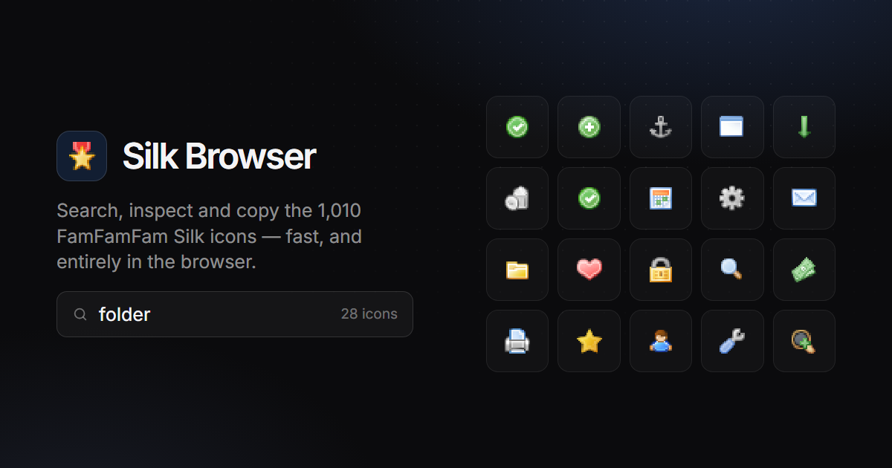

# Silk Icons Browser

A lightning-fast, keyboard-driven browser for all 1,010 [FamFamFam "Silk"](https://www.famfamfam.com/lab/icons/silk/) icons.

Instantaneous client-side search across categorized sets, flexible pixel-grid scaling (16px to 48px), and single-keystroke asset copying.  
Built for developers who want clean tools without bloat.

<div align="center">
  
</div>

**Live:** <https://silk.bzbb.dev> · **Source:** <https://github.com/Be1zebub/silk-icons-browser>

## What is in here

- **Search** over the icon names, plus a synonym and category vocabulary.
  Typo tolerant, prefix aware, and it highlights what matched.
- **Categories** — all 167 name prefixes mapped onto 16 semantic ones. The
  chips count the results of the current query, so the bar is a facet filter.
- **A virtualised grid.** Only the rows on screen are in the DOM, so the
  scrollbar thumb stays the same size all the way down.
- **A related strip.** Pick an icon and the strip shows its family, ranked by
  how specific the evidence is.
- **Copy name / Copy class / Copy rule / Copy PNG.**
- **A global popularity counter.** Every copy is counted per icon name —
  nothing else, no identifier, no IP, no timestamp. The counts are batched and
  posted to a Pages Function, stored in KV, and come back as the **Popular**
  category. Without the KV binding the app still works, it just has no
  global ranking.

## Deploying

The build output is a plain static site in `dist/`.

**Cloudflare Pages** — connect the repository and set:

- build command `npm run build`
- output directory `dist`

`public/_headers` already carries the cache rules: hashed assets are immutable
for a year, the HTML entry point is never cached.

`VITE_SITE_URL` is already set to `https://silk.bzbb.dev` in `.env`, which is
what makes the Open Graph image and the canonical URL absolute. Change it if
you deploy somewhere else.

### The popularity counter

`functions/api/usage.ts` is a Pages Function that keeps the copy counters in
a KV namespace:

- `POST /api/usage` with `{ counts: { icon: 3 } }` adds to the counters
- `GET /api/usage` returns the counters

Create a KV namespace and bind it as `USAGE` in the Pages dashboard
(Settings → Functions → KV Namespace bindings). Without the binding the
function answers `204` and drops the data, so the site keeps working and the
**Popular** category simply does not appear. The client batches its copies and
flushes them every 30 seconds, so a visitor costs one KV write per batch
rather than one per copy.

**Anywhere else** — `npm run build` and serve `dist/`. Asset paths are
relative, so a sub path works too. The Pages Function needs a KV binding (or
any endpoint that speaks the same two routes — point `VITE_USAGE_ENDPOINT` at
it).

## Commands

```
npm run dev         # dev server on :5178
npm run build       # production build into dist/
npm run check       # svelte-check
npm test            # unit tests
npm run bench       # search latency
npm run probe -- q  # try a query from the terminal
npm run build:og    # re-render public/og.png (needs the chromium build)
```

Regenerating the OG image needs a browser:

```
npx playwright install chromium
```

## How the search works

`scripts/build-catalog.mjs` compiles the catalog into an index at build time:
an inverted token → icon map, the synonym table, the category words and the
related-icon map. Nothing is tokenised at runtime except the query itself.

At query time each token is scored against the candidate icons in tiers — exact
name, whole-name alias, exact segment, name prefix, segment prefix, alias,
squashed name, subsequence, then a bounded edit distance as a last resort. The
final score is the sum of the token scores times the share of tokens that
matched, so a full match always outranks a partial one.

Roughly 0.15 ms per query over the full set of 1,010 icons.

The icon artwork is repacked onto a 16px grid and re-encoded losslessly, which
takes the spritesheet from 446 KB to 290 KB. `scripts/verify-sprite.mjs`
compares it against the upstream sheet pixel by pixel.

## Credits

Icon artwork by [Mark James](https://www.famfamfam.com/lab/icons/silk/),
CC BY 2.5. Everything else is MIT.

The visual language is inspired by [Toolcraft](https://github.com/pixel-point/toolcraft)
by Pixel Point.  
The interface icons are [Lucide](https://lucide.dev).
